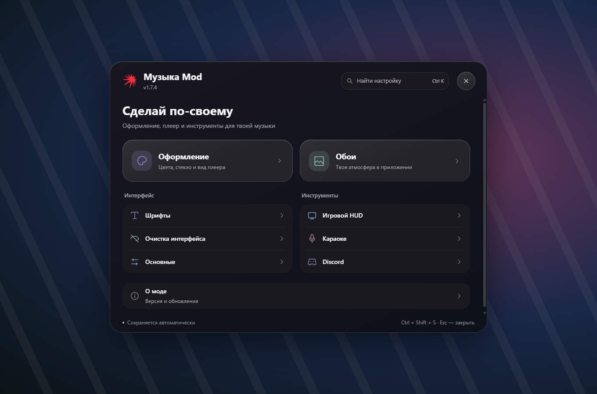
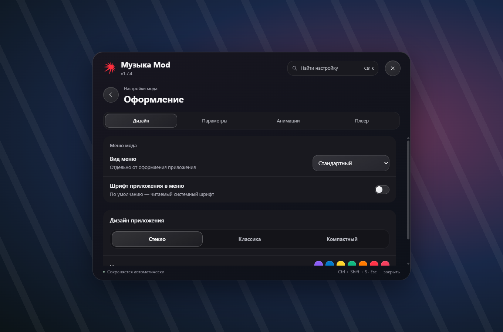
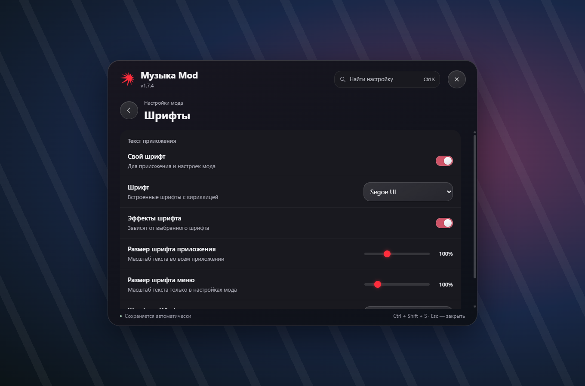
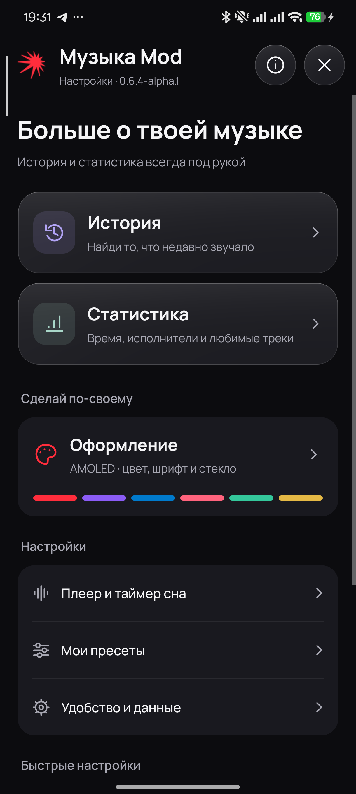
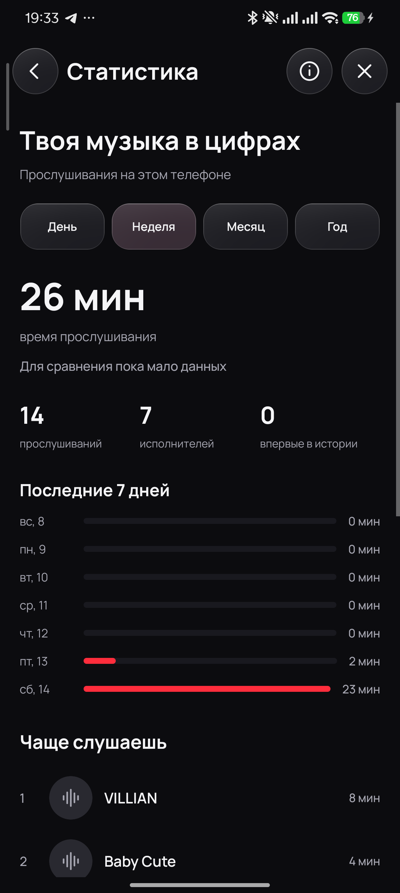

# Яндекс Музыка Mod

Оригинальная Яндекс Музыка с дополнительными возможностями для **Windows и Android**. На ПК — полноэкранный плеер, обои, HUD и оформление. На телефоне — нативная навигация и воспроизведение, история, статистика и настройки мода.

  
  

**[Скачать обе версии из Releases →](https://github.com/velqor1/Mod-Yandex-Music/releases/latest)** · [Что нового](CHANGELOG.md) · [Сообщить об ошибке](https://github.com/velqor1/Mod-Yandex-Music/issues)

| Платформа | Версия мода | Базовый клиент | Файл в релизе |
| --- | --- | --- | --- |
| Windows x64 | **1.7.4** | 5.124.1 | `YandexMusic-Mod-1.7.4-win-x64.exe` |
| Android | **0.6.4-alpha.1** | 2026.11.1 #171rur | `YandexMusic-Mod-0.6.4.apk` |

## Windows

- **Новое компактное меню.** Главная с разделами, поиск по настройкам, подразделы, сохранение выбранной страницы и прокрутки.
- **Оформление на выбор.** Спокойный стандартный вид меню, стекло, классический и компактный варианты. Стиль меню можно выбирать отдельно от плеера.
- **Шрифты и читаемость.** Свой шрифт приложения, отдельный шрифт меню, независимый масштаб текста настроек до 200%.
- **Полноэкранный плеер в стиле Apple Music.** Крупная обложка, фон в цветах трека, тексты с подсветкой доступных таймкодов.
- **Живые обои.** Видео, GIF, импорт поддерживаемых пакетов Wallpaper Engine и каталог обоев.
- **Игровой HUD и караоке.** Компактное управление поверх окон, режим сквозных кликов и отдельное окно текста.
- **Discord Rich Presence.** Текущий трек, обложка и прогресс в профиле Discord; интеграцию можно отключить.
- **Очистка интерфейса.** Настройки скрытия промоблоков, концертов и других ненужных элементов.
- **Обновления мода.** Проверка новых Windows-релизов, предложение скачать, прогресс, отмена и проверка SHA-256. Установка запускается отдельным нажатием, с резервной копией.

### Меню ПК-версии

  

  
  

Снимки ПК-меню сделаны на изолированном стенде с кодом релиза; фон демонстрационный. Стеклянный материал и пользовательский шрифт включаются отдельно.

### Установка и обновление Windows

1. Скачайте **EXE** из [последнего релиза](https://github.com/velqor1/Mod-Yandex-Music/releases/latest).
2. Запустите установщик. Он обновляет установленный клиент в своей папке, сохраняя аккаунт, настройки и пользовательские обои.
3. Настройки открываются через красный значок мода или `Ctrl + Shift + S`.

**Пользователям 1.5.0 и прежних сборок нужно один раз установить новый EXE вручную.** После этого мод сам проверяет Windows-релизы: через 10 секунд после готовности интерфейса и каждые 6 часов. В «О моде» есть ручная проверка. Можно отложить предложение на сутки или пропустить конкретную версию. Музыка продолжает играть во время загрузки; закрытие приложения происходит только после выбора установки.

Обновления оригинального клиента заблокированы отдельно: обновляется мод для указанной базовой версии. Android APK из релизов Windows-обновлятор пропускает.

| Сочетание | Действие |
| --- | --- |
| `Ctrl + Shift + S` | Открыть / закрыть настройки мода |
| `Ctrl + K` в настройках | Перейти к поиску |
| `Esc` | Закрыть настройки |
| `Ctrl + Shift + O` | Открыть / свернуть игровой HUD |
| `Ctrl + Shift + G` | Сквозные клики HUD |
| `Ctrl + Shift + L` | Показать / скрыть плавающее караоке |

## Android

Это мод **оригинального APK**, со штатным аккаунтом, поиском, коллекцией и движком воспроизведения.

- **Полное воспроизведение без активного Плюса.** Проверено на аккаунте без подписки на POCO X6 Pro; серверная доступность отдельных записей может различаться.
- **Настройки в стиле ПК-мода.** Красный знак, понятные разделы, AMOLED, акцент, шрифты, размер текста и стеклянные элементы управления.
- **Главная и Коллекция.** «Главная» открывает «Мою волну». Подложка нижней панели плавно перемещается и меняет направление при повторном нажатии.
- **История на телефоне.** Поиск по треку, исполнителю и альбому, выбор дня, просмотр недослушанных записей, обложки и переход к выбранной песне.
- **Статистика круглый год.** День, неделя, месяц и год; время прослушивания, частые треки и исполнители, динамика по дням и сравнение с прошлым периодом.
- **Тексты песен.** Обычный текст и синхронизация по строкам, когда источник предоставляет таймкоды.
- **Удобство.** Таймер сна, режим экономии, настройка экрана и сохранение пресетов оформления.
- **Очистка интерфейса.** Скрытие лишних вкладок и части промоблоков, согласованная нижняя навигация на основных и вложенных экранах.

История и статистика собираются локально после включения записи в моде. Это не импорт всей истории Яндекс-аккаунта. Запись можно отключить, данные — очистить в настройках. Массовое управление коллекцией, умные папки и статистика жанров в этот выпуск **не входят**.

### Скриншоты с телефона

  
  
  

Свежие снимки версии 0.6.4-alpha.1 с POCO X6 Pro, Android 16. Имя и логин аккаунта не отображаются.

### Установка и обновление Android

1. Скачайте **APK** из [последнего релиза](https://github.com/velqor1/Mod-Yandex-Music/releases/latest).
2. Откройте файл на телефоне и при необходимости разрешите установку из выбранного браузера или файлового менеджера.
3. Устанавливайте поверх предыдущего мода с той же подписью — аккаунт, настройки и скачанная музыка сохраняются.
4. На «Моей волне» нажмите красный знак мода. Крестик закрывает настройки, не сбрасывая их.

APK подписан ключом мода, поэтому поверх официального приложения с другой подписью он не установится. Удаление приложения стирает его локальные данные, включая скачанную музыку. Обновления Android пока устанавливаются вручную из Releases.

**Статус Android — альфа.** Основная проверка выполнена на POCO X6 Pro / Android 16; совместимость с другими устройствами может отличаться. Тексты и таймкоды есть не для всех песен. Все рекламные форматы не гарантированно скрыты, оформление отдельных экранов дорабатывается. Караоке и HUD в Android не добавлялись.

## Проверки и исходники

Состав и результаты проверки релиза: [RELEASE_CHECKS_RU.md](docs/RELEASE_CHECKS_RU.md). Сборка и локальная разработка: [BUILD_RU.md](docs/BUILD_RU.md). В релизе есть `SHA256SUMS.txt`; `windows-update.json` предназначен для обновлятора Windows.

## Обратная связь

Создайте [Issue](https://github.com/velqor1/Mod-Yandex-Music/issues): платформа и версия мода, шаги воспроизведения, ожидаемый и фактический результат. Для Android добавьте модель телефона и версию системы; для ошибки текста — трек и исполнителя. Перед отправкой скриншотов скройте имя, логин и другие личные данные.

## О проекте

Неофициальный проект; не связан с Яндексом. Права на «Яндекс Музыку» и её материалы принадлежат правообладателям. Возможности зависят от базового клиента и серверных изменений.
