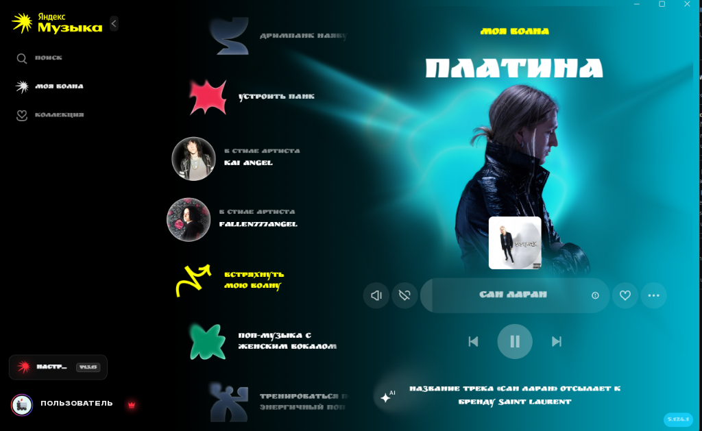
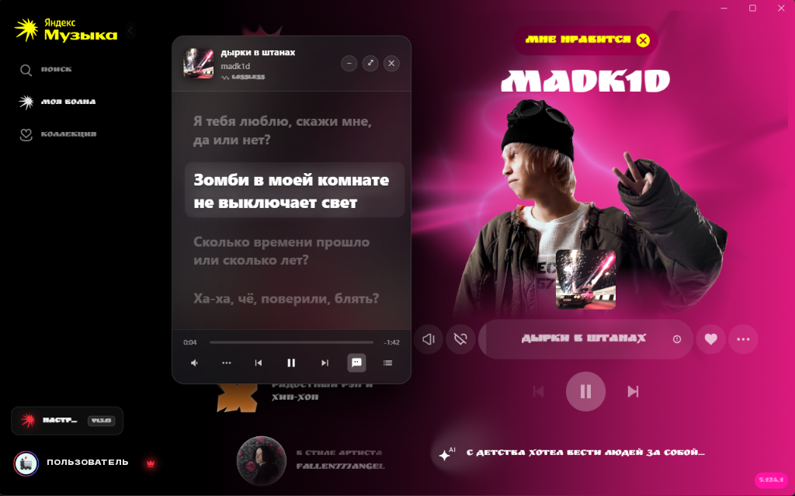
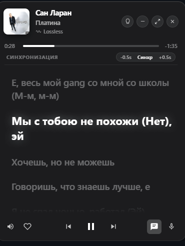
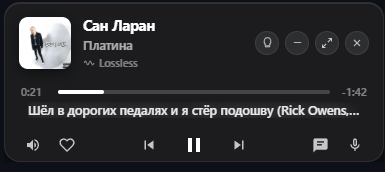
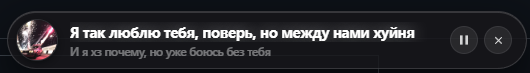
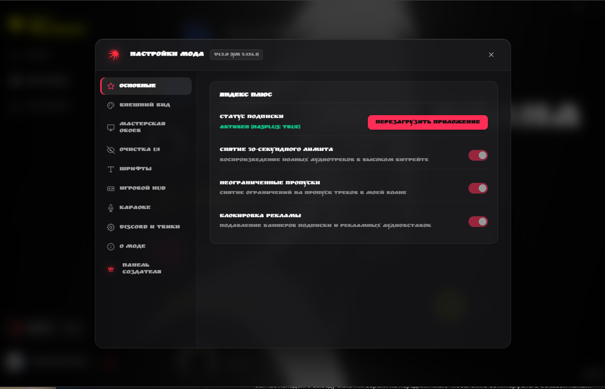
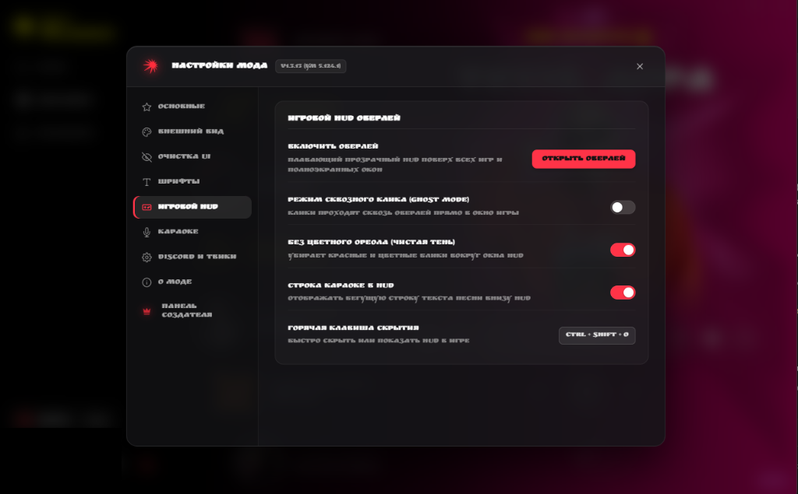
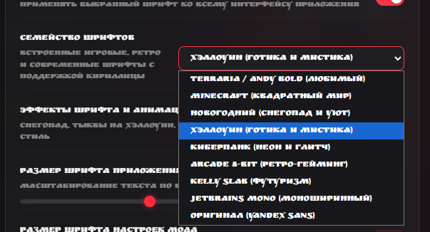

# 🎵 Яндекс Музыка — мод без Плюса (v1.3.13)

Набор премиальных модификаций для официального десктопного приложения **Яндекс Музыка (версия 5.124.1)**: полнофункциональный **Яндекс Плюс**, игровой HUD-оверлей поверх всех окон, синхронные тексты песен (Караоке в стиле Apple Music), Discord Rich Presence, кастомные игровые и сезонные шрифты с эффектами и матовый дизайн из темного стекла.

<p align="center">
  
</p>

<p align="center">
  
</p>

<p align="center">
  <a href="https://github.com/velqor1/Mod-Yandex-Music/releases/latest">
    
  </a>
  
  
  
  
</p>

> [!TIP]
> **Установка в 1 клик:** просто скачайте готовый установщик [Yandex_Music_x64_5.124.1_Mod.exe](https://github.com/velqor1/Mod-Yandex-Music/releases/latest), запустите его — он автоматически установит модифицированный клиент с красивыми ярлыками!

---

## ❤️ Преимущества и возможности

### 💎 Яндекс Плюс навсегда без ограничений:
- ✔️ **Снятие 30-секундного лимита** — воспроизведение полных аудиотреков без подписки (`hasPlus: true`).
- ✔️ **Неограниченные пропуски** — переключайте треки в «Моей Волне» сколько угодно без ограничений.
- ✔️ **Блокировка рекламы** — полное отключение аудиовставок, баннеров подписки и промо-блоков.
- ✔️ **Максимальный битрейт** — поддержка чистого HQ звука 320 kbps и FLAC Lossless.

---

### 🎤 Синхронные тексты песен и Караоке (Apple Music Style):
- 🎶 **Синхронная подсветка строк** — текст песни следует за вокалом в реальном времени с плавной анимацией.
- ⏱️ **Точная подстройка синхронизации (`-0.5s / +0.5s`)** — регулируйте смещение таймкодов на лету прямо в окне текста!
- 🧠 **3-уровневый интеллектуальный резолвер текстов**:
  1. *Официальные караоке-таймкоды Яндекс Музыки* (когда доступны в каталоге).
  2. *Международная база LRCLib* — миллионы синхронизированных lrc-текстов треков со всего мира.
  3. *Genius с фильтрацией переводов* — загружает чистый оригинальный текст без английских переводов и романизаций с адаптивным вокальным оффсетом.
- 💬 **Плавающий Караоке-виджет (`Ctrl + Shift + L`)** — компактная плавающая капсула с текстом поверх всех окон.

---

### 🎮 Игровой HUD-оверлей поверх игр (`Ctrl + Shift + O`):
- 🕹️ **Компактный плеер поверх любых игр** (CS2, Dota 2, Minecraft, GTA V, Valorant и др.).
- 👻 **Сквозной режим Ghost Mode (`Ctrl + Shift + G`)** — клики мыши проходят сквозь оверлей в игру; при наведении на кнопки активируется управление.
- 🌑 **Режим «Чистая тень»** — возможность убрать цветные ореолы вокруг оверлея для строгой темной эстетики.
- 📜 **Бегущая строка караоке** — отображение текущей строчки текста песни прямо внутри HUD-плеера.

---

### 🔤 Кастомные шрифты и атмосферные темы:
Полная поддержка кириллицы и латиницы во всех встроенных шрифтах:
- 🗡️ **`Terraria / Andy Bold (Любимый)`** — культовый рукописный геймерский шрифт.
- ⛏️ **`Minecraft (Квадратный мир)`** — пиксельный ретро-стиль с кубическим шармом.
- ❄️ **`Новогодний (Снегопад и уют)`** — праздничная зимняя атмосфера.
- 🎃 **`Хэллоуин (Готика и мистика)`** — мистический готический стиль с тематическим оформлением.
- 🌆 **`Киберпанк (Неон и глитч)`** — неоновый футуризм и глитч-эффекты.
- 👾 **`Arcade 8-Bit (Ретро-гейминг)`** — аркадный олдскул эпохи игровых автоматов.
- 📐 **`Kelly Slab (Футуризм)`** — строгая геометрическая геометрия и хай-тек.
- 💻 **`JetBrains Mono (Моноширинный)`** — идеальный шрифт для разработчиков и гиков.
- 🟡 **`Оригинал (Yandex Sans)`** — стандартный чистый шрифт приложения.
- ✨ **Сезонные визуальные эффекты**: падающий снегопад, тыквы на Хэллоуин, паутина и неоновый глитч.
- 📏 **Масштабирование шрифта**: гибкий слайдер размера шрифта приложения и окна настроек (от 80% до 150%).

---

### 💎 Премиальный матовый дизайн (Frosted Dark Glass):
- 🪟 **Настоящий Glassmorphism** — глубокое размытие фона (`backdrop-filter: blur(28px - 44px)`).
- 🎨 **Выбор интенсивности стекла**: Без размытия / Мягкое стекло (14px) / Премиум стекло (28px) / Глубокое матовое (44px).
- 🌈 **Палитра неоновых акцентов** + свободный колорпикер любого цвета интерфейса.
- 🪐 **Динамическая подсветка**: обложки с 3D-подъемом при наведении, неоновый прогресс-бар и подсветка плеера в такт музыке.

---

### 🧹 Очистка интерфейса (Clean UI):
- 🚫 Скрытие ненужных пунктов бокового меню: *Концерты, Детям, Подкасты и книги, Тренды, Радио*.
- 🚫 Полное удаление промо-баннеров и плашек «Установите приложение на телефон».
- 🚫 Скрытие лишних элементов в плеере (дизлайк, кнопка очереди, фуллскрин).
- 🚫 Скрытие донатов, билетов и трейлеров на страницах артистов.
- ⚡ **Оптимизация для игр**: отключение тяжелой фоновой 3D-анимации «Моя Волна» для максимального FPS в играх.

---

### 💜 Discord Rich Presence & Панель создателя:
- 🎧 **Нативный Discord RPC** — статус воспроизведения, обложка альбома, название трека, автор и живой таймкод в Discord без сторонних утилит.
- 👑 **Панель предложений создателю** — отправляйте идеи новых функций и пожелания напрямую разработчику прямо из меню мода!
- 🔄 **Автоматическая проверка обновлений** — всегда актуальная версия с уведомлением о новых фичах.

---

## 📸 Скриншоты мода

### 🌊 Главный экран «Моя Волна» и кастомный шрифт:
<p align="center">
  
</p>

### 🎤 Синхронное Караоке в реальном времени и полноэкранный плеер:
<p align="center">
  
</p>

### ⏱️ Окно текста песен с точной подстройкой синхронизации (`-0.5s / +0.5s`):
<p align="center">
  
</p>

### 🎮 Компактный игровой HUD-оверлей поверх окон и игр (`Ctrl + Shift + O`):
<p align="center">
  
</p>

### 💬 Плавающий Караоке-виджет на рабочем столе (`Ctrl + Shift + L`):
<p align="center">
  
</p>

### ⚙️ Меню настроек мода — Статус Яндекс Плюс и основные функции:
<p align="center">
  
</p>

### 🕹️ Меню настроек мода — Игровой HUD-оверлей и тонкая настройка:
<p align="center">
  
</p>

### 🔤 Меню выбора кастомных шрифтов и сезонных эффектов:
<p align="center">
  
</p>

---

## 💻 Как установить и пользоваться

### Вариант 1 (Рекомендуемый — через готовый установщик):
1. **[Скачайте последнюю версию Yandex_Music_x64_5.124.1_Mod.exe](https://github.com/velqor1/Mod-Yandex-Music/releases/latest)** из вкладки Releases.
2. Запустите файл `Yandex_Music_x64_5.124.1_Mod.exe`.
3. Установщик распакует Яндекс Музыку со всеми встроенными модами, создаст ярлыки на рабочем столе и в меню Пуск и сразу запустит плеер!

---

### Вариант 2 (Для разработчиков — из исходного кода):
Если у вас установлен Python:
```powershell
# Клонировать репозиторий
git clone https://github.com/velqor1/Mod-Yandex-Music.git
cd Mod-Yandex-Music

# Запустить скрипт внедрения мода
python tools/inject.py
```

---

## ⌨️ Горячие клавиши

| Хоткей | Действие |
| :--- | :--- |
| **`Ctrl + Shift + O`** | Открыть / свернуть игровой HUD-оверлей поверх окон |
| **`Ctrl + Shift + G`** | Включить / выключить сквозной режим кликов (Ghost Mode) |
| **`Ctrl + Shift + L`** | Открыть / скрыть плавающее Караоке с текстом песни |
| **`F12`** / **`Ctrl + Shift + I`** | Открыть инструменты разработчика (DevTools) |

---

## 📁 Структура проекта

```
├── assets/                  # Скриншоты, баннеры, логотипы и иконка проекта
├── src/
│   ├── main/                # Electron Main: IPC-мосты, Discord RPC, LRCLib и Genius резолверы
│   ├── preload/             # Безопасные Preload-контексты окон приложения
│   ├── renderer/            # Меню мода, перехват экспериментов, матовые стили, кастомные шрифты
│   ├── overlay/             # Игровой HUD-плеер (HTML / CSS / JS)
│   ├── karaoke/             # Плавающий караоке-виджет
│   └── fonts/               # Встроенные WOFF2 шрифты с кириллицей
├── tools/
│   ├── installer.py         # Исходный код графического установщика
│   ├── native_installer.nsi # Скрипт сборщика нативного инсталлятора NSIS
│   ├── inject.py            # CLI-инжектор мода в app.asar
│   ├── restore.py           # Восстановление чистой оригинальной версии
│   ├── asar_tool.py         # Высокоскоростной упаковщик архивов Electron
│   └── verify.py            # Автоматические тесты целостности компонентов
└── README.md
```

---

## ⚠️ Отказ от ответственности (Disclaimer)
Этот проект создан исключительно в ознакомительных и исследовательских целях для изучения архитектуры приложений на базе Electron и протоколов IPC. Все права на торговую марку «Яндекс Музыка» принадлежат компании ООО «Яндекс».
